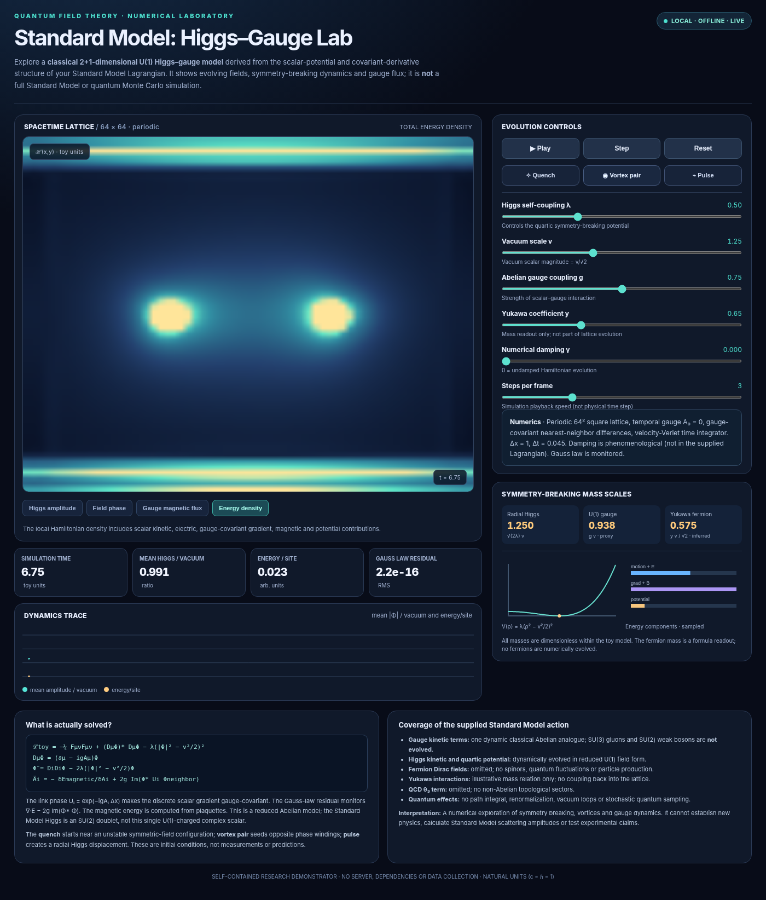

# Standard Model: Higgs–Gauge Lattice Lab

<!-- ENUMINOUS-UNIFIED-NAV:START -->
## Repository navigation

**eNuminous network:** [All public repositories](https://github.com/enuminous/EFMW/blob/main/REPOSITORY_NAVIGATION.md) · [EFMW](https://github.com/enuminous/EFMW) · [102 equations](https://github.com/enuminous/Monolithic_102_EFMW) · [Frozen Lean](https://github.com/enuminous/Monolithic-102-Zoo-Lean4) · [Zoo](https://github.com/enuminous/Tortoise) · [Papers](https://github.com/enuminous/papers) · [Quantum geometry](https://github.com/enuminous/Base888-Quantum-Geometry)

**This project:** [Repository home](https://github.com/enuminous/Higgs-Gauge-Lab) · [Subject index](https://github.com/enuminous/EFMW/blob/main/REPOSITORY_NAVIGATION.md#fundamental-physics-cosmology-and-quantum-geometry)

<details open>
<summary><strong>On this page</strong></summary>

- [Launch](#launch)
- [What you can do](#what-you-can-do)
- [Model implemented](#model-implemented)
- [Verification and inspection](#verification-and-inspection)
- [Files (flat repository)](#files-flat-repository)
- [Rights and attribution](#rights-and-attribution)
- [Connected physics research units](#connected-physics-research-units)


</details>

**Related repositories:** [Standard-Model-Reduction](https://github.com/enuminous/Standard-Model-Reduction) · [EFMW-Physics-Lab](https://github.com/enuminous/EFMW-Physics-Lab) · [Quantum-Gravity](https://github.com/enuminous/Quantum-Gravity) · [QST](https://github.com/enuminous/QST) · [Base888-Quantum-Geometry](https://github.com/enuminous/Base888-Quantum-Geometry) · [EFMW-Grid](https://github.com/enuminous/EFMW-Grid) · [EFMW](https://github.com/enuminous/EFMW) · [papers](https://github.com/enuminous/papers)

> **Evidence boundary:** A link between projects is navigation, not an assertion of proven equivalence, experimental validation, or shared authorship. See each repository’s own status and review notes.
<!-- ENUMINOUS-UNIFIED-NAV:END -->


**An interactive, standalone lattice-field simulation, inspired by the Higgs and gauge sectors of the Standard Model Lagrangian.**

> **Model boundary:** This is a **classical 2+1-dimensional Abelian–Higgs (U(1)) toy model**, not a simulation of the complete quantum Standard Model. It does not numerically evolve SU(3) or SU(2) gauge fields, fermions, Yukawa vertices or the QCD theta term.



## Launch

- **Local:** Open [`index.html`](index.html) in a modern desktop or mobile browser.
- **GitHub Pages:** Upload the files in this ZIP directly to the root of a repository, then go to **Settings → Pages → Build and deployment → Deploy from a branch**. Choose `main` and `/(root)`; GitHub Pages will serve `index.html` as the website.

No installation, build step, server, network connection, external assets or JavaScript libraries are needed. All CSS and JavaScript are inline in `index.html`.

## What you can do

- Run, pause, take a single time step, or reset.
- Select **Quench**, **Vortex pair** or **Pulse** initial conditions.
- Switch between four displays: **Higgs amplitude**, **scalar phase**, **gauge magnetic flux**, and **total energy density**.
- Adjust Higgs self-coupling `λ`, vacuum scale `v`, Abelian gauge coupling `g`, and phenomenological damping `γ`.
- Adjust playback steps per frame. The integrator time step is fixed.
- Inspect normalized mean field magnitude, energy per site, Gauss-law RMS residual, illustrative mass scales, potential shape and time histories.
- Adjust Yukawa parameter `y` for a **mass formula readout only**; the fermion field is not part of the simulation.

## Model implemented

The evolved toy Lagrangian is

```text
L_toy = -(1/4) F_munu F^munu + (D_mu Phi)* (D^mu Phi)
        - lambda (|Phi|^2 - v^2/2)^2,
D_mu Phi = (partial_mu - i g A_mu) Phi.
```

The model evolves a single complex scalar `Phi` and a U(1) gauge field in temporal gauge `A_0=0`. The full Standard Model contains a non-Abelian `SU(3) × SU(2) × U(1)` gauge sector and a Higgs **doublet**, so the fields shown are a deliberately simplified analogue, not individual Standard Model particles.

Numerical setup: a `64 × 64` periodic lattice, `Δx=1`, fixed `Δt=0.045`, gauge-link covariant nearest-neighbor differences and a velocity-Verlet update. Natural dimensionless toy units are used (`c=ℏ=1`). Nonzero damping is a phenomenological modification, not a term in the supplied Standard Model Lagrangian.

See [PHYSICS.md](PHYSICS.md) for equations, interpretation, coverage and validation guidance.

## Verification and inspection

Open the browser's developer console and, once the page is loaded, try:

```js
HiggsGaugeLab.pause();
HiggsGaugeLab.reset('pulse');
const before = HiggsGaugeLab.getState();
HiggsGaugeLab.advance(100);
const after = HiggsGaugeLab.getState();
console.table({ before, after });
```

For a **conservative energy check**, set damping `γ=0`, keep all physical parameters fixed and compare `energyPerSite` before and after stepping. A numerical energy drift is not itself evidence of physical energy nonconservation; it depends on step size and initialization. Monitor `gaussRms` separately. These tests do **not** validate the model against quantum field theory or experimental data.

Because the quench uses random initialization, its exact numerical evolution will differ on each reset; the pulse and vortex initial conditions are deterministic for fixed controls.

## Files (flat repository)

| File | Purpose |
| --- | --- |
| `index.html` | Complete, self-contained application and simulation |
| `README.md` | Startup instructions, model summary and deployment |
| `PHYSICS.md` | Physics assumptions, scope and technical notes |
| `preview.png` | Visual preview for the repository |

## Rights and attribution

This package does **not** specify an open-source license or transfer ownership. If you want to permit reuse, distribution or modification, add a `LICENSE` file reflecting the terms you choose. Publishing to a public GitHub repository without a license is not itself a grant of blanket reuse rights.

<!-- ENUMINOUS-RESEARCH-CHAIN:START -->
## Connected physics research units

**Established-theory reconstructions and baseline laboratories:** [Standard-Model-Reduction](https://github.com/enuminous/Standard-Model-Reduction) · [Higgs-Gauge-Lab](https://github.com/enuminous/Higgs-Gauge-Lab) · [EFMW-Physics-Lab](https://github.com/enuminous/EFMW-Physics-Lab)

**Proposed quantum-geometry bridge:** [Base888-Quantum-Geometry](https://github.com/enuminous/Base888-Quantum-Geometry) · [QST-001](https://github.com/enuminous/Quantum-Gravity/blob/main/QST-001.md) · [QST-002](https://github.com/enuminous/QST/blob/main/QST-002.md)

**EFMW definitions, pressure-cycle model, and spacetime investigations:** [Canonical 102 equations](https://github.com/enuminous/Monolithic_102_EFMW) · [Frozen Lean review](https://github.com/enuminous/Monolithic-102-Zoo-Lean4) · [RHC-001: Rahasya pressure-cycle formalization](https://github.com/enuminous/papers/blob/main/RHC-001-EFMW-Rahasya-Pressure-Cycle-Formalization.md) · [EFMW-Lagrangian](https://github.com/enuminous/EFMW-Lagrangian) · [Cosmology](https://github.com/enuminous/Cosmology)

> **Interpretation:** Cross-links represent research dependencies and comparisons. The Standard Model and continuum gravity are inputs in current QST calculations; their emergence from Base888 and the physical status of the pressure cycle remain **UNRESOLVED**.
<!-- ENUMINOUS-RESEARCH-CHAIN:END -->
